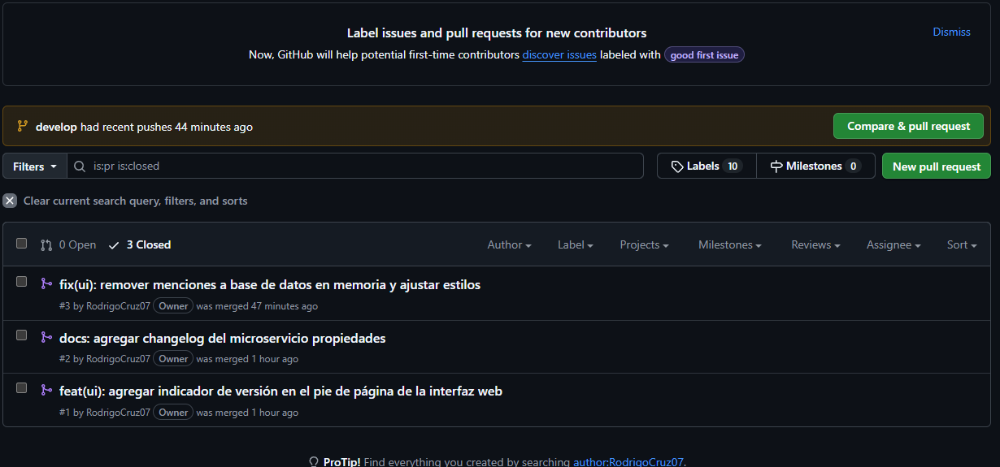
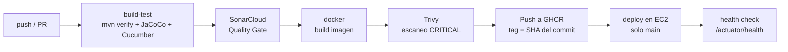

# Propiedades — Microservicio de riesgo propiedades

Microservicio del **caso caso11 — InmoNube** (Plataforma inmobiliaria). Evaluación Parcial N°1 (microservicio) y **Evaluación Parcial N°2 (pipeline CI/CD, contenedores y despliegue en AWS EC2)**.

| | |
|---|---|
| Asignaturas | JVY0101 — Java: Soluciones Nativas en Nube (EP1) · DOY0101 — Ingeniería DevOps (EP2) |
| Stack | Spring Boot 3.3 · Java 21 · Maven · Spring Data JPA · H2 · springdoc-openapi |
| Calidad | JaCoCo cobertura LINE 100% · Cucumber (BDD) alineado a endpoints REST |
| CI/CD | GitHub Actions · SonarCloud · Trivy · Dependabot · GHCR |
| Despliegue | Docker Compose (app + MySQL) en AWS EC2 |

## Responsabilidad (SRP)

administra los datos y la lógica del dominio de Propiedades del caso caso11 (InmoNube). Su base de datos es una **H2 en memoria** (un solo microservicio por base), cumpliendo aislamiento de datos por dominio.

## Página de presentación

Al ejecutar el servicio, `http://localhost:8080/` muestra la página de presentación del microservicio con documentación y enlaces a:

- **Swagger UI**: `/swagger-ui/index.html`
- **OpenAPI (yaml)**: `/v3/api-docs.yaml`
- **ReDoc**: `/redoc.html`
- **H2 Console**: `/h2-console`

## Endpoints

| Método | Ruta | Descripción |
|--------|------|-------------|
| GET | `/api/propiedads` | Lista todos los recursos |
| GET | `/api/propiedads/{id}` | Obtiene un recurso por id |
| POST | `/api/propiedads` | Crea un recurso |
| PUT | `/api/propiedads/{id}` | Actualiza un recurso |
| DELETE | `/api/propiedads/{id}` | Elimina un recurso |

## Documentación del proyecto

La documentación completa está en la carpeta [`docs/`](docs/):

- [`docs/00_Resumen.md`](docs/00_Resumen.md) — propósito, responsabilidad y tecnologías
- [`docs/01_Arquitectura.md`](docs/01_Arquitectura.md) — componentes, arquitectura y patrones
- [`docs/02_API.md`](docs/02_API.md) — contrato REST y ejemplos curl
- [`docs/03_Pruebas.md`](docs/03_Pruebas.md) — tests unitarios, cobertura y Cucumber
- [`docs/04_Despliegue.md`](docs/04_Despliegue.md)
- [`docs/05_Justificacion.md`](docs/05_Justificacion.md) — justificación del servicio: RF/RNF/seguridad cubiertos, stack y por qué cada tecnología AWS
- [`docs/diagramas/`](docs/diagramas/) — C4 (contexto, contenedores, componentes), secuencia e infraestructura AWS — Docker, Docker Compose e integración

## Cómo ejecutar locmente

```bash
mvn spring-boot:run
```

## Cómo ejecutar con Docker

```bash
docker compose up --build        # app + MySQL
# http://localhost:8080/actuator/health
```

> El compose usa el perfil `prod` (MySQL): Swagger UI y ReDoc están disponibles (se pueden apagar con `SWAGGER_ENABLED=false`), pero la **consola H2 solo existe en modo local** (`mvn spring-boot:run`), porque en producción la base es MySQL.

## Cómo ejecutar las pruebas

```bash
mvn test      # unit tests + Cucumber
mvn verify    # + verificación de cobertura JaCoCo (100% LINE, falla si baja)
```
# Ramificación

Elegimos GitFlow porque el curso abarca todo el semestre y cada entrega (EP01, EP02, EP03) representa un hito estable que requiere un control riguroso de versiones. Este flujo nos permite usar la rama develop para integrar continuamente las funcionalidades de ambos integrantes sin comprometer la estabilidad de main, al tiempo que nos da la flexibilidad de resolver errores críticos en producción mediante ramas hotfix/ sin interrumpir el avance del resto del equipo. De este modo, la separación clara entre el código de integración y las versiones definitivas asegura un historial limpio, ordenado y con la trazabilidad necesaria para cumplir con cada una de las rúbricas de evaluación del proyecto.


## Convención de commits
| Tipo | Para qué | Ejemplo |
| :--- | :--- | :--- |
| `feat` | Nueva funcionalidad | `feat(ui): agregar pie de pagina` |
| `fix` | Corrección de bug | `fix(home): corregir titulo` |
| `docs` | Documentación | `docs: agregar changelog` |
| `chore` | Tareas / CI | `chore(ci): agregar workflow hola mundo` |

Formato: 
Aqui son algunos commits que se hizo en el trabajo con su tipo: y su respectiva descripcion del cambio que se hizo    

fix(ui): remover menciones a base de datos en memoria y ajustar estilos     
docs: agregar changelog del microservicio pagos     
feat(ui): agregar indicador de versión en el pie de página de la interfaz web

## Naming de ramas
Aqui se veran el naming de las ramas que se ocupo para el trabajo y estas cumplen con una funcion que primero va su tipo ya sea feature o hotfix y despues va el cambio que se va a hacer y en que parte.

feature/changelog   
feature/pagina-presentacion         
hotfix/subtitulo-pagina

## Flujo de merge
Features y hotfix siempre entran por pull request, nunca push directo a main o develop.

Podemos ver en la imagen los Pull Request y los Merge que se hicieron respectivamente a cada rama y que como bien se dijo anteriormente hay una rama llamada develop en la que se hicieron los PR y que si surge un imprevisto se hace de la misma manera de un PR y se revisa y se hace Merge a la rama main
## Estrategia de revisión
La estrategia de revision de nuestro repositorio fue de que uno se encargaba de hacer un feature o hotfix o lo que corresponda y le hacia PR a la rama Develop pero este no pasaba altiro a merge sino que se mantenia en espera para ser revisado y poder hacer los test correspondientes de que estaba en funcionamiento y si no habia ningun error se le hacia el merge correspondiente 
## Conclusiones 
Me gusto la parte de poder saber los tipos de commit o ramas  ya que los desconocia y que se ocupan una descripcion corta y lo otro ya lo conocia mas o menos el hacer los cambios y el disparador del workflow aunque este ultimo me dio un poco de problemas en el ultimo paso para hacer un PR en main pero lo pude arreglar debido a que tenia el workflow en develop y no en main.
---

# Pipeline CI/CD (Evaluación Parcial 2)

Archivo: [`.github/workflows/ci-cd.yml`](.github/workflows/ci-cd.yml)



| Etapa | Qué hace | Se ejecuta en | Bloquea si falla |
|---|---|---|---|
| `build-test` | `mvn verify`: pruebas unitarias (JUnit/Mockito), BDD (Cucumber) y cobertura JaCoCo (mínimo 100% de líneas) | PR y push a `develop`/`main` | Sí |
| SonarCloud | Análisis estático + Quality Gate (`sonar.qualitygate.wait=true`) | PR y push | Sí |
| `docker` | Construye la imagen (multi-stage, usuario no root, HEALTHCHECK) | PR y push | Sí |
| Trivy | Escanea la imagen; falla con vulnerabilidades CRITICAL con corrección disponible | PR y push | Sí |
| Publicación | Sube la imagen a GHCR (`:<sha>` y `:latest`) | push a `develop`/`main` | — |
| `deploy` | Copia `docker-compose.yml` a la EC2, `docker compose pull` + `up -d` | solo push a `main` (entorno `production`) | — |
| Health check | Consulta `/actuator/health` en la EC2 hasta ver `UP` | después del deploy | Sí |

Además, **Dependabot** ([`.github/dependabot.yml`](.github/dependabot.yml)) revisa semanalmente dependencias Maven, imagen base Docker y acciones de GitHub, y abre PR hacia `develop`.

## Trazabilidad (desarrollo → producción)

- Cada cambio entra por **Pull Request** (GitFlow: `feature/*` → `develop` → `main`), y el workflow queda ligado al commit y al PR.
- La imagen se etiqueta con el **SHA del commit** y contiene las etiquetas OCI `org.opencontainers.image.revision` y `.source`: desde la imagen en ejecución se puede llegar al commit exacto y a la ejecución del pipeline.
- La EC2 ejecuta siempre `ghcr.io/<repo>:<sha>`; el `.env` del servidor registra la imagen desplegada.
- El historial de *Actions* + el entorno `production` de GitHub muestran quién y cuándo desplegó cada versión.

## Calidad y seguridad

- **Calidad:** cobertura JaCoCo con umbral (`mvn verify` falla si baja), Quality Gate de SonarCloud, reportes de pruebas y cobertura publicados como artefactos del pipeline.
- **Seguridad:** Dependabot (dependencias), Trivy (imagen), SonarCloud (código), contenedor sin root, secretos solo en *GitHub Secrets* (nunca en el repositorio), `permissions:` mínimos en el workflow, perfil `prod` sin consola H2 ni `show-sql` (Swagger configurable con `SWAGGER_ENABLED`).
- **Escalabilidad / recursos:** límites de CPU y memoria por contenedor en `docker-compose.yml`, `MaxRAMPercentage` en la JVM, `restart: unless-stopped`, healthchecks y `depends_on: service_healthy`.

## Orquestación

`docker-compose.yml` define dos servicios (`propiedades-svc` y `db` MySQL), red interna `backend`, volumen persistente `db-data`, healthchecks y límites de recursos. La base de datos **no** se expone al exterior; solo el puerto 8080 de la aplicación.

## Secretos y configuración requerida

En *Settings → Secrets and variables → Actions* del repositorio:

| Secreto | Descripción |
|---|---|
| `SONAR_TOKEN` | Token de SonarCloud |
| `EC2_HOST` | IP pública (idealmente Elastic IP) de la EC2 |
| `EC2_USER` | Usuario SSH (`ec2-user` en Amazon Linux, `ubuntu` en Ubuntu) |
| `EC2_SSH_KEY` | Contenido completo de la llave privada `.pem` |
| `DB_PASSWORD` | Clave de MySQL en producción |

Además: crear el *Environment* `production` (Settings → Environments), y en `pom.xml` reemplazar `sonar.organization` y `sonar.projectKey` por los valores de SonarCloud.

## Preparar la EC2 (una sola vez)

1. Lanzar una instancia (Amazon Linux 2023 o Ubuntu) y asignarle una **Elastic IP**.
2. Security Group: SSH (22) y TCP 8080 de entrada.
3. Instalar Docker y el plugin Compose:
   ```bash
   # Amazon Linux 2023
   sudo dnf install -y docker && sudo systemctl enable --now docker
   sudo usermod -aG docker ec2-user
   sudo mkdir -p /usr/local/lib/docker/cli-plugins
   sudo curl -SL https://github.com/docker/compose/releases/latest/download/docker-compose-linux-x86_64 \
        -o /usr/local/lib/docker/cli-plugins/docker-compose
   sudo chmod +x /usr/local/lib/docker/cli-plugins/docker-compose
   ```
4. Cerrar sesión y volver a entrar para aplicar el grupo `docker`.
5. Hacer push a `main`: el pipeline despliega solo.

## Uso de Inteligencia Artificial

Se ocupo la IA para ayudar a armar el pipeline y para los errores que se produjeran en el proceso 

## Conclusiones y reflexiones individuales

En Conclusion en este trabajo hicimos un pipeline mas largo y con muchos mas pasos , que varias veces pusheaba el codigo a main y esperaba a que pasara todo en verde pero justo en una se me caia o se ponia en X porque fallo una seguridad o habia una variable mal escrita pero esto me hace mejorar y como tambien mejorar el codigo ya que los mismos errores que me salian al hacer push y que tenia una vulnerabilidad se arreglaban y se pusheaba denuevo y ese error ya no aparecia y era un alivio. Tambien aprendi nuevas tecnologias que no conocia como sonarqube y como se conectaba a un repositorio y que este mismo analizaba el codigo del repositorio y que vulnerabilidades tenia y eso me hizo reconocer que el codigo que uno escribe o ya esta siempre puede mejorar o ser mas seguro.
